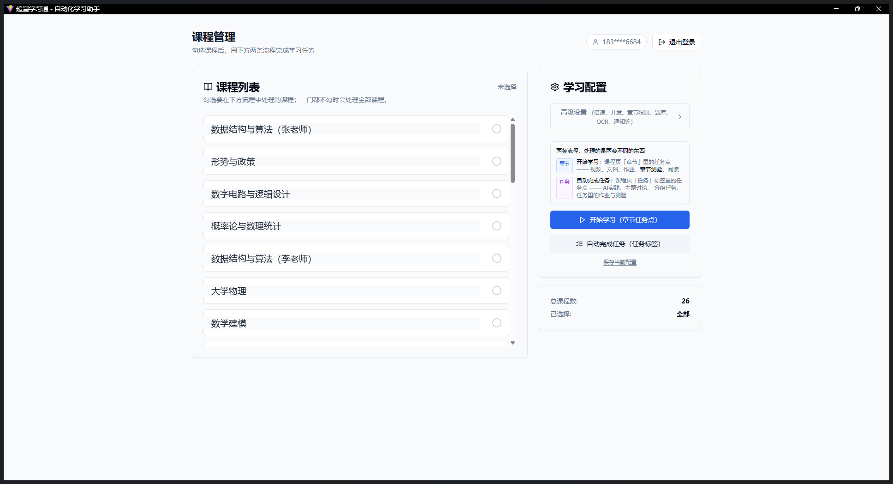
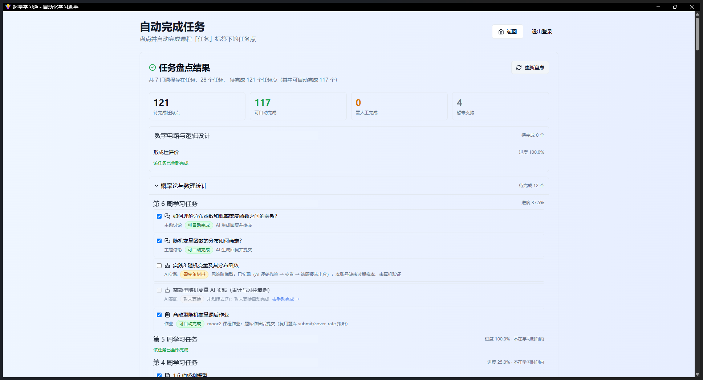

<div align="center">

# 超星学习通课程自动化助手

**带图形界面的超星学习通助手 · Web / Windows 桌面版 / 命令行**

自动完成课程里的视频、文档、章节、作业、测验，
以及**原项目完全没有的「任务」模块**（AI 实践 / 主题讨论 / 分组任务 …）。

只要内容会写进你的账号，**默认只生成、你逐条批准后才提交**。

<a href="https://github.com/xxxop111/chaoxing-fanya/stargazers"></a>
<a href="https://github.com/xxxop111/chaoxing-fanya/network/members"></a>
<a href="LICENSE"></a>
<a href="https://github.com/xxxop111/chaoxing-fanya/actions/workflows/tests.yml"></a>




</div>

---

## ✨ 这个 fork 做了什么

<table>
<tr><td width="50%" valign="top">

### 🆕 补上「任务」模块

超星有**两套互不相通**的系统：

- `mooc1` 的**章节任务点** —— 原项目已支持
- `task.chaoxing.com` 的**「任务」标签** —— 原项目完全没有

后者就是课程页左侧那个「任务」。本项目补了整层：
任务点发现 → 类型适配注册表 → **12 个处理器**
（视频 / 音频 / 文档 / 章节 / 作业 / 测验 / 自测 / 主题讨论 / 分组任务 / AI 实践…）

</td><td width="50%" valign="top">

### 🛡️ 生成 → 审批 → 提交

会写进你账号的内容（作业答案、讨论回复、AI 实践作答…）
**默认只生成、不提交**，在「待审批」面板里摊开给你看，
你逐条核对过才真正提交。

> 动机很实际：早期版本直接把内容交上去过，出过事故。

</td></tr>
<tr><td valign="top">

### 📊 盘点会直说"做不到什么"

勾选前先**只读盘点**：每个任务点的类型、完成条件、
**能否自动完成**、不能的话**为什么**
（`需先备材料` / `暂未支持` / `学习窗口未开放`）。

界面上标成"可自动"的类型，背后一定有真的处理器 ——
`effective_status()` 会把没有处理器的类型自动降级。

</td><td valign="top">

### 🔍 逆向出来的协议文档

把实测出来的任务引擎接口写成了
[docs/FANYA_TASK_API.md](docs/FANYA_TASK_API.md)，
**逐条标注「已验证 / 推断 / 未验证」**。

这是仓库里最"别人没有"的部分。

</td></tr>
</table>

---

## 🚀 快速开始

### Windows 一键（推荐）

```bash
git clone --depth=1 https://github.com/xxxop111/chaoxing-fanya
cd chaoxing-fanya
start.bat
```

浏览器会自动打开 `http://localhost:3000`，登录后即可使用。

### 打包成桌面版（可选）

```bat
build_desktop_app.bat deploy
```

产物是 `dist\chaoxing-fanya\chaoxing-fanya.exe`：**无控制台黑框**，
双击即用，关窗口即退出。

<details>
<summary><b>其他运行方式（Docker / 前后端分开 / 命令行）</b></summary>

**Docker**
```bash
docker build -t chaoxing .
docker run -it chaoxing
# 挂载自定义配置：
docker run -it -v /本地路径/config.ini:/config/config.ini chaoxing
```

**前后端分开**
```bash
pip install -r requirements.txt
python app.py            # 后端 http://localhost:5000

cd web && npm install && npm run dev   # 前端 http://localhost:3000
```

**命令行**
```bash
python main.py                                  # 章节任务点
python main.py --fanya-tasks                    # 只盘点「任务」模块（只读）
python main.py --fanya-tasks --fanya-execute    # 盘点并执行
```

</details>

---

## 📸 界面

**任务盘点** —— 摊开每个任务点的类型、进度和**能做到什么程度**。
留意 `需先备材料`、`暂未支持` 这类标注：工具会直接告诉你它哪里做不到，
而不是假装全能。



---

## ⚠️ 先看这里：它做不到什么

> 任何逆向实现的工具都会随平台改版**静默失效**。下面是已知边界，请先确认能接受：

- **未实测 / 半自动**：主题讨论的实际发帖、测验的正式交卷、上传作品的多附件、
  「情景对话」模式
- **不支持**：作业 / 测验的自动重做（平台重做是自有 UI 流程，请求格式未探明）；
  分组任务默认**拒绝覆盖组员已写的内容**
- **AI 实践 · AI剧情（type=7）**：链路已打通（发言 → 交卷 → 评分）。
  此前这里写过「评分必须由浏览器建立会话」—— **那是错的**：根因只是
  `evaluate/stream` 的 `recordUuid` 传错了记录。传**章节记录**会得到
  「会话不存在」，传**外层记录**服务端就正常应答（已做对照实测）。
  ⚠️ 该模式**交卷不可逆**（部分课程记录 `enableReset=false`），
  所以界面默认不代你提交，需要你自己确认
- **解析脆弱**：接口全是逆向来的，平台改版需人工发现。解析层有 17 个单元测试，
  但**接口层没有自动化测试**
- **学术规范**：部分题目原文要求「用自己的话整理、禁止复制 AI 输出」，
  工具对此默认只出草稿。请自行判断是否符合你所在课程的要求

**使用本项目产生的一切后果由使用者自行承担。**

---

## 📖 深入

<details>
<summary><b>「任务」模块支持到什么程度（实测清单）</b></summary>

<br>

管理端流程：**盘点（只读）→ 勾选 → 生成 → 逐条批准 → 提交**。

| 任务类型 | 状态 | 说明 |
| --- | --- | --- |
| 视频 / 文档 / 章节 / 知识点 | ✅ 自动 | 学习进度上报，不进审批（不产生可审阅内容）|
| 音频 | ✅ 自动 | 与视频同构；本账号无该类型样本，未实测 |
| 主题讨论 | ✅ 自动（已实测）| AI 生成回复并提交；提交前先检测是否已回复，避免重复 |
| 作业 | ✅ 自动（审批后提交）| 题库作答，**默认只准备不提交** |
| AI实践 · 代码实践 | ✅ 自动（**实测得分 76**）| AI 生成代码 → 自测校验 → 建卷交卷 → SSE 出分 |
| AI实践 · 思维阶梯 | ✅ 自动（**实测得分 85**）| 拆题 → 逐题作答（含多选）→ 交卷 → 结题报告出分 |
| AI实践 · 上传作品 | ⚠️ 半自动（实测得分 93）| 生成作品 → 渲染 PNG → 传网盘 → 挂附件 → 交卷 |
| AI实践 · 情景对话 | ⚠️ 半自动 | 已实现且带中止保护；本账号无未过期样本 |
| AI实践 · AI剧情 | ⚠️ 需确认 | 链路已打通；**交卷不可逆**，故不代提交 |
| 自测 / 测验 | ⚠️ 半自动 | 题库作答；**默认只暂存不交卷** |
| 分组任务 | ⚠️ 半自动 | 可生成后提交；默认拒绝覆盖组员已有内容 |
| 问卷 / 线下课堂 | ⚠️ 需人工 | 走超星 OA 表单 / 教师侧记录，客户端不上报 |

全库盘点（26 门课）：**待完成任务点 127 个，其中可自动完成 122 个（96%）**。

</details>

<details>
<summary><b>审批模式下每个类型具体做什么</b></summary>

<br>

| 类型 | 审批模式下的行为 |
| --- | --- |
| 作业 | 只读题 + 查题库，**不保存草稿、不提交**（写请求数为 0）；批准后才提交 |
| 主题讨论 | 只生成回复正文并展示，批准后才发帖 |
| AI实践 · 代码实践 | 只生成代码并跑完自测，批准后才建卷交卷 |
| AI实践 · 思维阶梯 / 情景对话 | 暂不支持"生成后暂停"，默认**拒绝直接交卷**；要直接交需开「允许 AI实践直接提交」 |
| 自测 / 测验 | 默认只逐题暂存，不交卷 |
| 分组任务 | 默认只生成，不提交；且小组已有内容时仍拒绝覆盖 |
| 视频 / 文档 / 章节 / 音频 | **不进审批**：只是学习进度上报 |

> 另有一条硬性防线：题库偶尔会把「我看不到题目，请提供文字描述」这类**拒答/元回复**
> 当成答案返回。这类文本会被识别并按「未命中」处理 —— 绝不会被写进作业
> （曾经真的发生过一次）。全部未命中时直接拒绝提交。

</details>

<details>
<summary><b>修掉过的静默失败（这类 bug 最危险）</b></summary>

<br>

「报告成功、其实做错」比崩溃更糟，因为你会信任它。已修：

- 课程作业**判断题**必须发 `true`/`false`，原来发「对/错」→ 服务端直接拒绝整份提交
- 上传作品的附件载荷是**扁平数组**而非卡片结构，发错时服务端返回
  `{"status":true}` 却静默忽略 → 交出没有附件的空记录。现在**交卷前回读校验**
- 配置文件带 UTF-8 BOM 时整份读不出（连带 `KeyError`），改用 `utf-8-sig`
- 前端轮询无失败处理 → 后端重启后永久转圈；现在有失败计数与超时上限

</details>

<details>
<summary><b>技术细节与踩坑记录</b></summary>

<br>

**桌面版启动优化**：原来用 `urllib` 探测 12 个端口判断"是否已有实例"，
本机装了代理时 `127.0.0.1` 也走代理，每个端口干等 1 秒超时 —— 白花 **12 秒**。
改为裸 socket 并行探测 + 绕过代理的 opener 后：**12.15s → 0.14s**。

**窗口方案**：Edge `--app` 模式（无地址栏、无标签栏）。曾尝试 pywebview 内嵌
WebView2 做真原生窗口，但本机走不通（pythonnet 在 .NET Framework 与 CLR 下
都无法解析 `Python.Runtime.Loader.Initialize`），故默认不再尝试，
换机器想试可设 `CHAOXING_USE_WEBVIEW=1`。

**关闭行为**：页面每 5 秒心跳，关窗口时用 `sendBeacon` 通知后端，
安静 15 秒后退出；浏览器被杀则心跳消失 180 秒后退出。
阈值比浏览器后台限流宽松，最小化不会误退出。

</details>

<details>
<summary><b>配置要点</b></summary>

<br>

- **登录**：账号密码，或 `cookies.txt`
- **题库 `[tiku]`**：`provider=Yanxi|Like|TikuAdapter|AI|SiliconFlow`；
  `cover_rate=0.0-1.0`；`submit=true|false`
- **通知 `[notify]`**：Server酱 / Qmsg / Bark / Telegram
- **OCR**：内置 PaddleOCR，或用外部大模型
  ```bash
  export CHAOXING_VISION_OCR_PROVIDER=openai
  export CHAOXING_VISION_OCR_KEY=sk-your-api-key
  export CHAOXING_VISION_OCR_MODEL=gpt-4o
  ```

</details>

<details>
<summary><b>开发与测试</b></summary>

<br>

```bash
.venv\Scripts\python.exe tests\test_parsers.py     # 单元测试（零依赖，不联网）
python tools/smoke_test.py 5000 <planId>           # 端到端冒烟（会真实执行）
```

测试覆盖**平台一改版就会静默失效**的解析层：选择题 JSON 解析、题库拒答识别、
题干要求识别（字数/轮次/禁止复制）、进度格式化、课程列表去重与同名课程区分。

</details>

<details>
<summary><b>目录结构</b></summary>

<br>

```
chaoxing-fanya/
├── app.py                  # Flask 后端入口（Web 版）
├── desktop_app.py          # 桌面版入口
├── main.py                 # 命令行入口
├── start.bat               # Windows 一键启动
├── build_desktop_app.bat   # 构建桌面版
├── api/
│   ├── fanya_task.py       # 「任务」模块：客户端 / 盘点 / 执行器 / 12 个处理器
│   ├── fanya_approval.py   # 待审批队列
│   ├── fanya_upload.py     # AI实践 · 上传作品
│   ├── fanya_ladder.py     # AI实践 · 思维阶梯
│   └── ...
├── docs/
│   ├── FANYA_TASK_API.md   # 任务引擎接口文档
│   └── legacy/             # 上游遗留文档（归档）
├── tests/test_parsers.py   # 单元测试
├── web/                    # 前端（React 18 + Vite + TailwindCSS）
└── resource/
```

</details>

---

## 常见问题

| 问题 | 处理 |
| --- | --- |
| 端口被占用 | `netstat -ano \| findstr :5000`，结束占用进程 |
| 依赖装不上 | 后端 `pip install -r requirements.txt --force-reinstall`；前端删 `node_modules` 与锁文件后重装 |
| 浏览器没自动打开 | 手动访问 `http://localhost:3000` |
| Docker 配置没生效 | 确认挂载路径，或在容器内检查 `/config/config.ini` |

---

## 致谢与许可

- 上游链条：[Samueli924/chaoxing](https://github.com/Samueli924/chaoxing)
  → [ymylive/chaoxing-fanya](https://github.com/ymylive/chaoxing-fanya)
  → [sweetcornna/chaoxing-fanya](https://github.com/sweetcornna/chaoxing-fanya)
  → 本项目
- 核心的 `api/` 逆向实现、题库抽象、章节任务处理来自上游，详见 [NOTICE](NOTICE)
- **许可证：GPL-3.0** —— 仅允许在相同许可证下开源免费使用与再分发，
  禁止闭源商业化及任何盈利行为
- 本项目仅供学习交流，使用者需自行承担法律与合规责任
